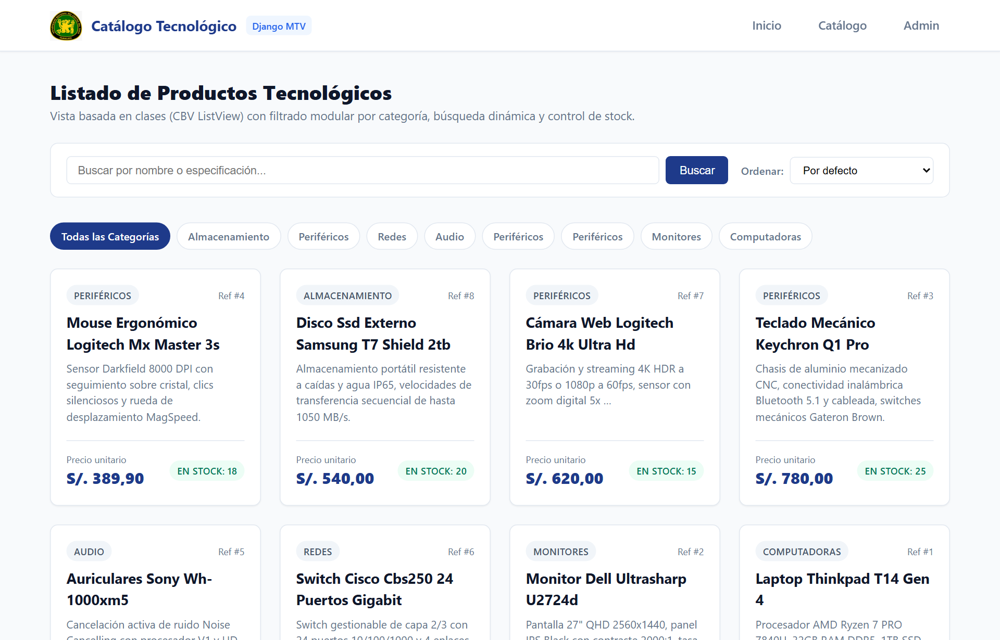
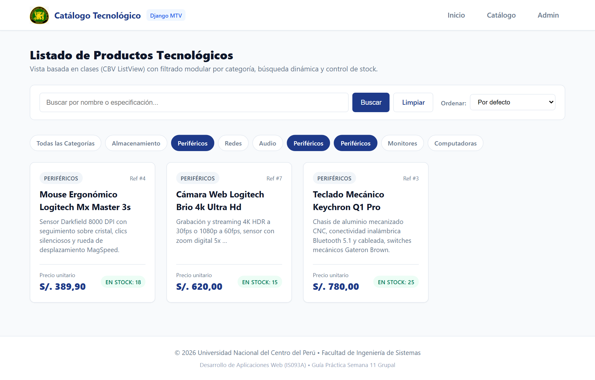
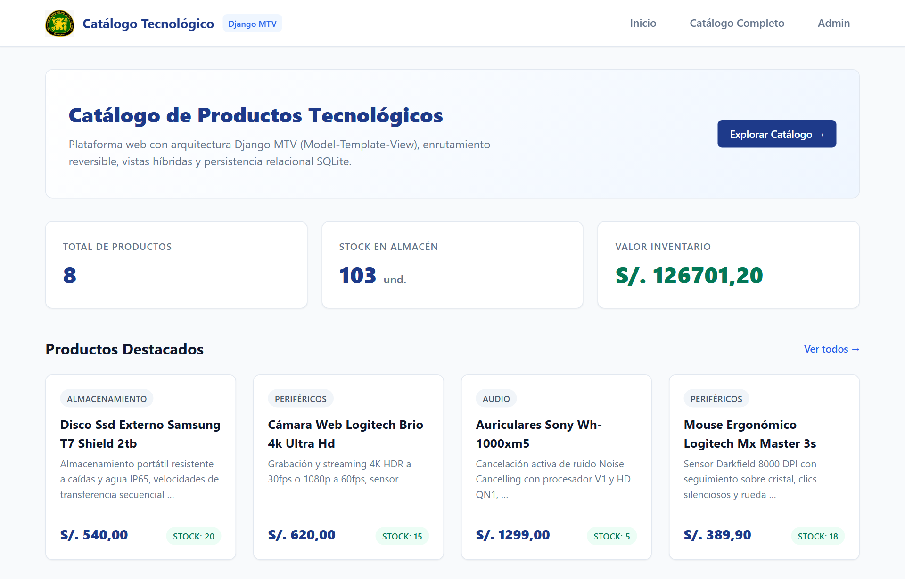

# Catálogo de Productos Tecnológicos (Django MTV)

> **Universidad Nacional del Centro del Perú**  
> **Facultad de Ingeniería de Sistemas**  
> **Asignatura:** Desarrollo de Aplicaciones Web (IS093A) — Semestre 2026-II  
> **Docente:** Ing. Miguel Aguilar  
> **Modalidad:** Práctica de Laboratorio Grupal (Semana 11)  

---

## Equipo de Desarrollo

| Integrante | Código UNCP | Perfil GitHub | Roles Técnicos Asignados |
|---|:---:|:---:|---|
| **José Pablo Osorio Mallqui** | `2022200839H` | [@StoneFind22](https://github.com/StoneFind22) | **Arquitecto Django & QA / ORM Validator**<br>Estructura MTV, `settings.py`, despacho de URLs raíz, modelo ORM `Producto`, ciclo de migraciones y suite TDD. |
| **Arlette D'Alessandra Suárez Román** | `2022200427L` | [@Adasuro](https://github.com/Adasuro) | **Desarrolladora de Vistas & Ingeniera de Plantillas**<br>Vistas híbridas FBV (`home`) y CBV (`ProductoListView`), filtros dinámicos, herencia de plantillas DTL en Tema Claro y diseño responsivo. |

---

## 1. Descripción del Proyecto

Aplicación web modular construida sobre **Django 5.x** aplicando rigurosamente el patrón arquitectónico **MTV (Model-Template-View)**. El sistema implementa un catálogo de productos tecnológicos desacoplado, con enrutamiento reversible (`name='home'`, `name='catalogo'`), vistas híbridas (**FBV** para tablero analítico y **CBV** con `ListView` para navegación paginada), persistencia relacional con el **ORM de Django** sobre SQLite, y un diseño visual en **Tema Claro** (DreamDesign) con badges condicionales de stock y filtrado dinámico.

---

## 2. Diagrama del Flujo Arquitectónico MTV

El patrón MTV de Django distribuye el ciclo de vida de cada solicitud HTTP de la siguiente manera:

```mermaid
flowchart TD
    Cliente([Cliente / Navegador Web]) -->|1. HTTP GET /catalogo/| Dispatcher[URL Dispatcher\nconfig/urls.py ➔ catalogo/urls.py]
    Dispatcher -->|2. Despacho de vista resuelta| View[Capa de Vista\nFBV home | CBV ProductoListView]
    View -->|3. QuerySet diferido| Model[(Capa de Modelo ORM\nProducto ➔ SQLite DB)]
    Model -.->|4. Entidades evaluadas| View
    View -->|5. Inyección de Contexto dict| Template[Motor de Templates DTL\nbase.html ➔ catalogo.html]
    Template -.->|6. HTML Renderizado 200 OK| Cliente
```

```text
  [ Cliente / Navegador Web ]
               │
               ▼  (1) HTTP GET Request (/catalogo/?categoria=Periféricos)
  ┌─────────────────────────────────────────────────────────────┐
  │ 1. URLs Dispatcher                                          │
  │    config/urls.py  ──include()──>  catalogo/urls.py         │
  └────────────────────────────┬────────────────────────────────┘
                               │
                               ▼  (2) Despacho de vista resuelta
  ┌─────────────────────────────────────────────────────────────┐
  │ 2. Capa de Vista (Views)                                    │
  │    catalogo/views.py  [FBV home | CBV ProductoListView]     │
  └──────────────┬──────────────────────────────▲───────────────┘
                 │                              │
     (3) QuerySet│                  (4) Entidades│
        Lazy eval│                     Python   │
                 ▼                              │
  ┌────────────────────────────┐                │
  │ 3. Capa de Modelo (ORM)    │                │
  │    catalogo/models.py      ├────────────────┘
  │    Producto (SQLite DB)    │
  └────────────────────────────┘
                 │
                 ▼  (5) Contexto inyectado (dict: 'productos', 'categorias')
  ┌─────────────────────────────────────────────────────────────┐
  │ 4. Motor de Templates (DTL)                                 │
  │    base.html (Herencia DRY)  <──  catalogo.html             │
  └────────────────────────────┬────────────────────────────────┘
                               │
                               ▼  (6) HTTP Response 200 OK (HTML renderizado)
  [ Cliente / Navegador Web ]
```

---

## 3. Consultas ORM y Demostración de Lazy Evaluation

En Django, los **QuerySets son perezosos (Lazy Evaluation)**: la declaración de una consulta no interactúa inmediatamente con la base de datos relacional. La sentencia SQL solo se compila y ejecuta cuando se requiere evaluar los resultados reales en memoria (al iterar en un bucle `for`, llamar a `list()`, `len()` o acceder por índice).

### QuerySet 1: Filtrado de Productos Disponibles Ordenados por Precio
```python
# Consulta diferida (No emite SQL al instanciarse):
queryset = Producto.objects.filter(stock__gt=0).order_by('precio')

# Se evalúa en la plantilla DTL al iterar sobre la lista de productos:
#  ... 
```

### QuerySet 2: Agrupación y Listado Único de Categorías para Filtrado
```python
# Extracción de valores escalares únicos diferida en memoria:
categorias = Producto.objects.values_list('categoria', flat=True).distinct()

# Se evalúa cuando la vista inyecta los filtros en el contexto y el template los recorre.
```

---

## 4. Estructura de Directorios del Repositorio

```text
proyecto/
├── assets/                          # Capturas requeridas del catálogo y terminales
│   ├── interfaz_home_fbv.png
│   ├── interfaz_catalogo_cbv.png
│   └── interfaz_catalogo_filtrado.png
├── catalogo/                        # Aplicación de dominio MTV
│   ├── migrations/                  # Historial de migraciones ORM
│   │   ├── 0001_initial.py
│   │   └── __init__.py
│   ├── admin.py                     # Panel de administración Django
│   ├── apps.py                      # Configuración de la aplicación
│   ├── models.py                    # Modelo ORM Producto (POO)
│   ├── tests.py                     # Suite de pruebas unitarias automatizadas (TDD)
│   ├── urls.py                      # Enrutador desacoplado (name='home', name='catalogo')
│   ├── views.py                     # FBV (home) y CBV (ProductoListView)
│   └── __init__.py
├── config/                          # Configuración raíz de Django
│   ├── settings.py                  # Variables de configuración, apps y templates
│   ├── urls.py                      # Enrutador principal con include()
│   ├── wsgi.py                      # Punto de entrada WSGI
│   └── asgi.py                      # Punto de entrada ASGI
├── static/                          # Archivos estáticos institucionales
│   └── img/logo-uncp.png
├── templates/                       # Plantillas DTL en Tema Claro (DreamDesign)
│   ├── base.html                    # Shell maestro con navegación
│   ├── catalogo.html                # Catálogo con filtros y estados de stock (CBV)
│   └── home.html                    # Bienvenida y métricas (FBV)
├── .gitignore                       # Exclusión estricta de .venv, db.sqlite3 y temporales
├── capture_browser.py               # Conector a Chromium/Chrome con Playwright
├── generate_evidence.py             # Generador de capturas CodeSnap con Pygments
├── manage.py                        # Orquestador CLI de Django
├── poblar_datos.py                  # Seeder de datos reales y verificación Lazy
└── requirements.txt                 # Manifiesto de dependencias exactas
```

---

## 5. Capturas de la Interfaz Renderizada (/catalogo/)

### 5.1. Catálogo General de Productos (CBV ListView en Tema Claro)


### 5.2. Catálogo con Filtrado Dinámico por Categoría


### 5.3. Página de Inicio y Métricas de Inventario (FBV)


---

## 6. Instalación y Puesta en Marcha

### 1. Clonar el Repositorio
```powershell
git clone https://github.com/UNCP-PROJECTS/aguilar-11.2.git
cd aguilar-11.2
```

### 2. Crear y Activar Entorno Virtual
```powershell
python -m venv .venv
.\.venv\Scripts\activate
```

### 3. Instalar Dependencias
```powershell
pip install -r requirements.txt
```

### 4. Ejecutar Migraciones y Poblar Base de Datos
```powershell
python manage.py migrate
python poblar_datos.py
```

### 5. Ejecutar Batería de Pruebas Unitarias
```powershell
python manage.py test catalogo
```

### 6. Levantar el Servidor de Desarrollo
```powershell
python manage.py runserver
```

Navegar a:
* **Inicio (FBV):** `http://127.0.0.1:8000/`
* **Catálogo (CBV):** `http://127.0.0.1:8000/catalogo/`
* **Panel Administrativo:** `http://127.0.0.1:8000/admin/`
